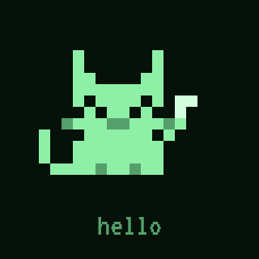
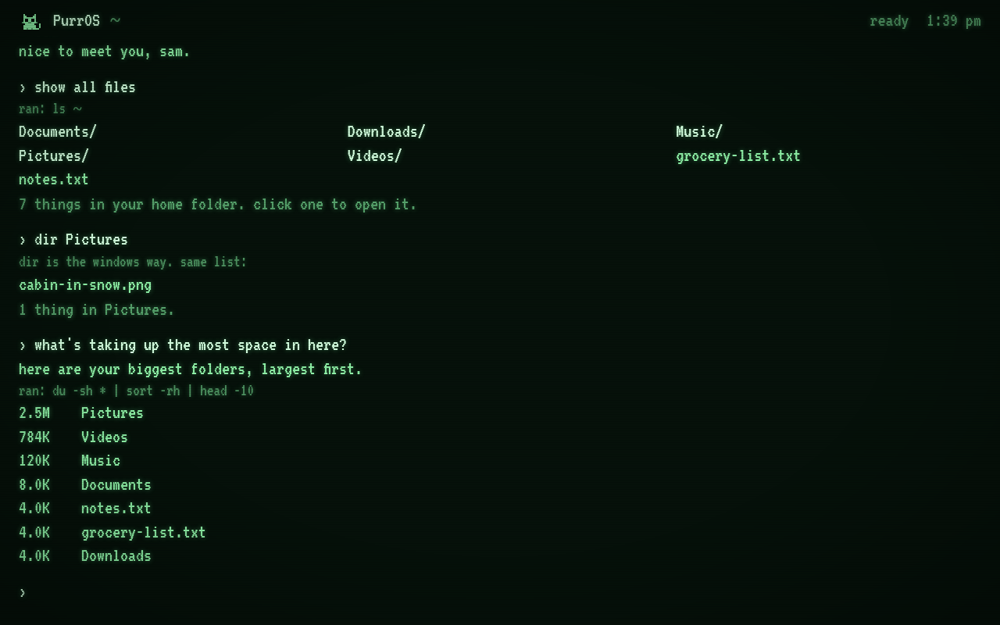
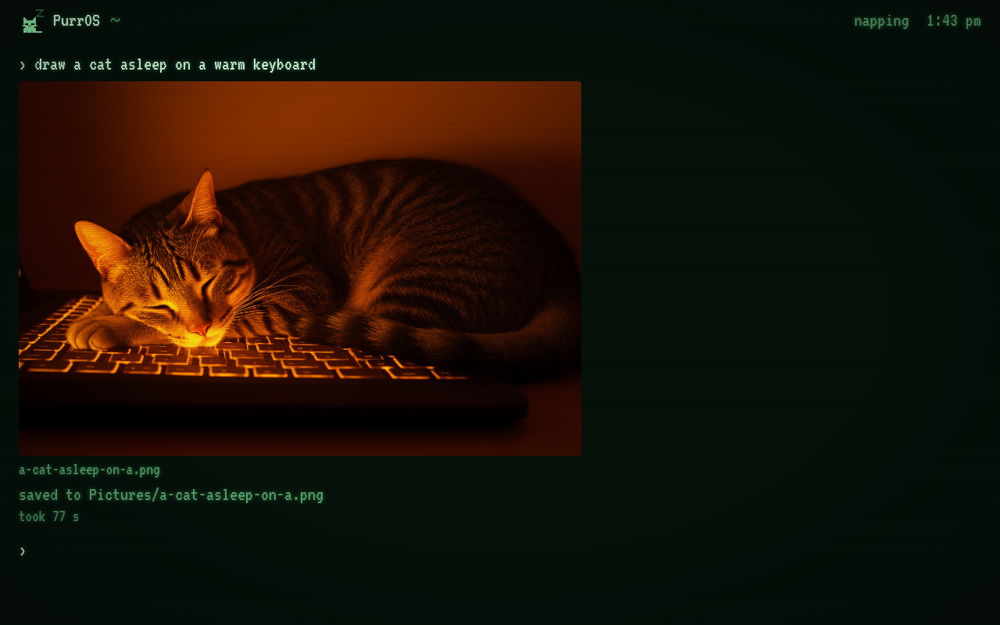
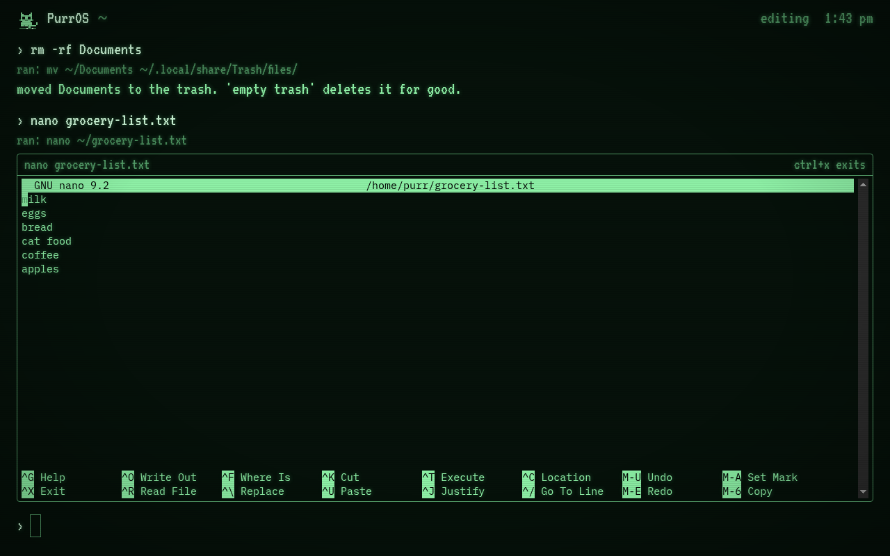
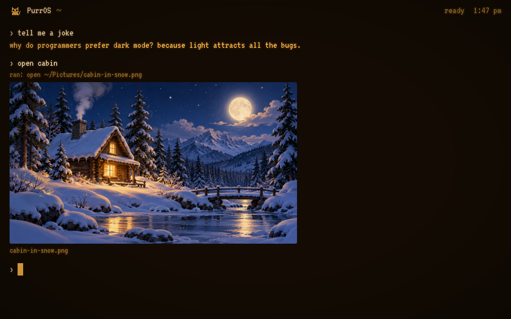

<p align="center"></p>

# PurrOS

A small, mostly text operating system that runs in a VM and looks like an old green terminal.
You type plain words or a command from Windows, Mac or Linux and it does what you meant. A
local AI model handles anything the built-in phrasebook doesn't know, and it can draw pictures.
It is meant for people who have never used a terminal as well as people who use one every day.



## What you can type

| You type | What happens |
|---|---|
| `show all files` | lists the folder you are in |
| `dir Pictures` | the Windows command works too, with a short note that `dir` is the Windows way |
| `open cabin` | finds `cabin-in-snow.png` without the full name and shows it on screen |
| `play beach-sunset.mp4` | plays the video in place |
| `edit notes.txt` or `nano notes.txt` | opens nano in a terminal pane that folds away when you exit |
| `rm -rf Documents` | moves Documents to the trash instead of deleting it |
| `what's taking up the most space in here?` | the brain picks `du -sh * \| sort -rh \| head -10` and runs it |
| `draw a fox asleep in a teacup` | makes the picture and saves it to Pictures |
| `tell me a joke` | tells one |
| `theme amber`, `settings` | changes the look (phosphor green, amber, ice, paper) |

Each line goes through the same steps in order: PurrOS words like `help` and `settings`,
plain English patterns, a phrasebook of cmd, PowerShell, Mac and Linux commands, any
program installed in the VM, and finally the brain. Most things never reach the brain, so
they answer instantly and still work with no model running.

When PurrOS starts, the cat waves, says hello and lists your home folder. On the first boot
it asks what to call you.







## How it is put together

- **The VM** is Alpine Linux 3.24 (linux-lts) under QEMU with KVM. It logs in the user
  `purr` automatically and runs Chromium in the cage kiosk compositor, pointed at purrd on
  127.0.0.1:7777. Kernel messages go to the serial port, so no boot text shows.
- **purrd** (`app/purrd`, Python and aiohttp) serves the screen and one WebSocket. It routes
  each line, runs commands, opens files and keeps the settings.
- **The screen** (`app/static`) is plain HTML, CSS and JavaScript with no build step.
  Interactive programs open in xterm.js panes. The cat is a 16x16 sprite drawn from code
  every frame, in the colors of the current theme.
- **The brain** is any Ollama or OpenAI-compatible chat model. It is asked for one JSON
  object: something to say, one command to run, or a picture prompt.
- **Pictures** come from `host/purr-host.py` on the host machine, or from any
  OpenAI-compatible images endpoint.
- The VM reaches the host at 10.0.2.2 through QEMU user networking. On the host, purrd is
  forwarded to 127.0.0.1:17777 and purr-host listens on 127.0.0.1:7790, so neither can be
  reached from the network.

## Safety

- Every command is sorted into read, change or danger before it runs. The check looks
  inside `$( )`, backticks, `<( )`, `sh -c`, `eval`, wrapper programs such as `env`,
  `timeout` and `xargs`, and `find -exec` and `-delete`.
- Deleting always means the trash (`~/.local/share/Trash`). `rm`, `del`, `rd` and
  `Remove-Item` all go there. `empty trash` asks once, then deletes for good.
- Anything in the danger group asks first. So does any change the brain suggests on its
  own; commands you typed yourself run as typed.
- purrd only accepts requests whose Host and Origin are local, so a web page open in the
  VM can't drive it.

## Running it

You need Linux or WSL2 with KVM (nested virtualization on, for WSL), and sudo for the
build. Developed on Ubuntu 24.04 under WSL2 on Windows 11.

```
git clone https://github.com/voidharbor/purros && cd purros
app/fetch-vendor.sh     # fonts and xterm.js, so the VM never needs the internet
host/install.sh         # installs QEMU, adds you to the kvm group, links ~/.local/bin/purros
sudo vm/build.sh        # builds vm/out/purros.qcow2 from Alpine packages, about 15 s once cached
purros                  # opens PurrOS in a window
```

Other launcher options: `purros --headless`, `purros --stop`, `purros --status`,
`purros --console` (serial shell inside the VM). After changing anything in `app/`,
`sudo vm/build.sh --app-only` refreshes the app inside the existing disk in about a second
and keeps the home folder and settings. The VM has to be off for that.

On Windows, `host/install-windows.ps1` puts a PurrOS shortcut on the Desktop and in the
Start menu. It currently has the WSL distro name and repo path written in it
(`Ubuntu-24.04` and `/Users/joshwald/purros`), so edit those two first.

## Brain and pictures

Type `settings` in PurrOS to change these. The defaults point at the host machine:

- Brain: Ollama at `http://10.0.2.2:11434`. Set the model to one you have pulled. Choose
  `openai` as the kind for any OpenAI-compatible server and add a key if it needs one.
- Pictures: `purr-host` at `http://10.0.2.2:7790`, which `purros` starts on the host. It
  runs an image script and returns the PNG. By default that script is a private local
  pipeline that isn't in this repo, so set `PURR_MOCKUP_CMD` to your own command (called as
  `<cmd> base <name> 1344 896 <seed> "<prompt>" --managed`) and `PURR_MOCKUP_DIR` to the
  folder it writes `<name>.png` into. Or set pictures to `openai` and use any images endpoint.

If the brain is down, PurrOS says so and everything that doesn't need it keeps working.

## The cat

Eleven moods, each with its own animation: hello, idle, listening, thinking, working,
searching, drawing, playing, done, oops and sleeping. It changes mood with what PurrOS is
doing and naps after 45 quiet seconds.

## Tests

```
python3 -m venv .venv && .venv/bin/pip install aiohttp
cd app && ../.venv/bin/python -m unittest discover -s tests    # router, safety, actions, server, brain
node --test tests/js/                                         # the cat and the mood queue
cd ../host && ../.venv/bin/python -m unittest test_purr_host
```

## Known gaps

- Sound needs the WSLg PulseAudio server. When that server hangs, `wsl --shutdown` brings it back.
- Trash has no restore command yet.
- Trashing the folder you are standing in leaves you in a folder that no longer exists.
- Searching a huge folder can stall the screen for a moment, since the walk runs on the server's only thread.
- A custom PurrOS shell is planned for later.

## License

MIT
